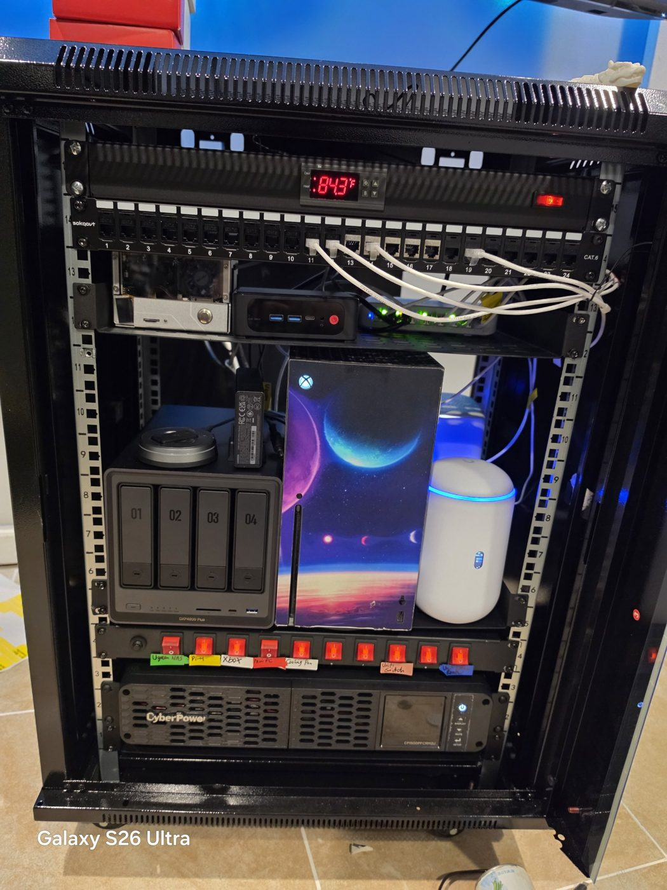
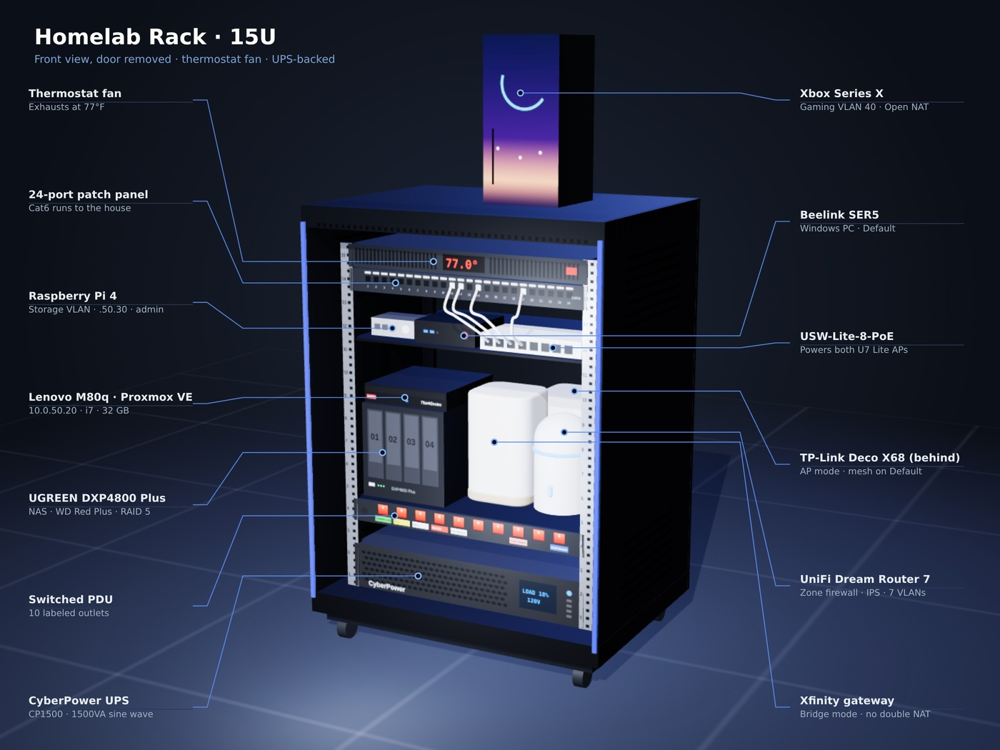
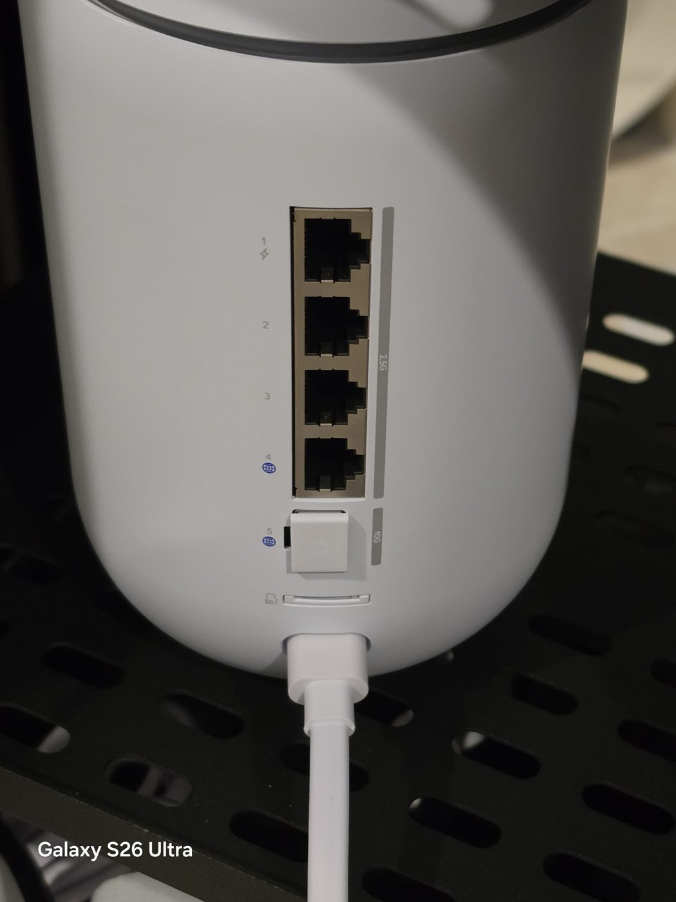
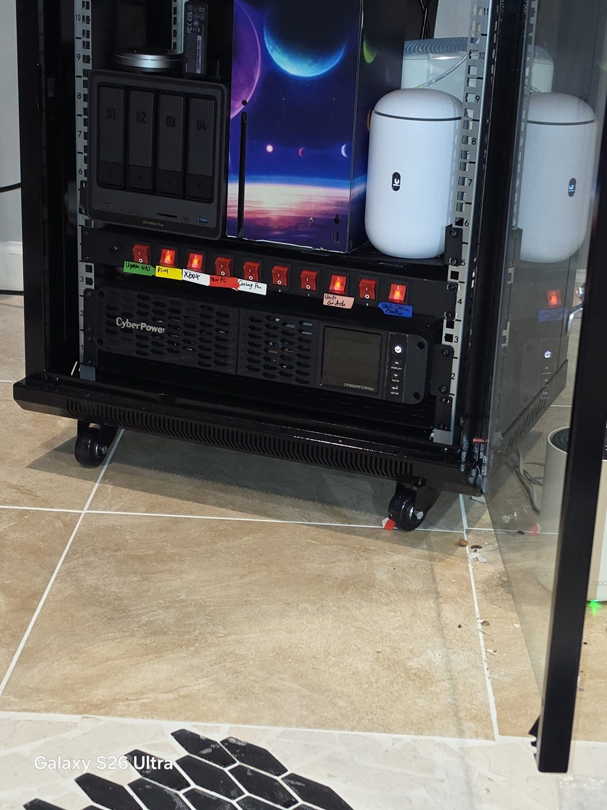
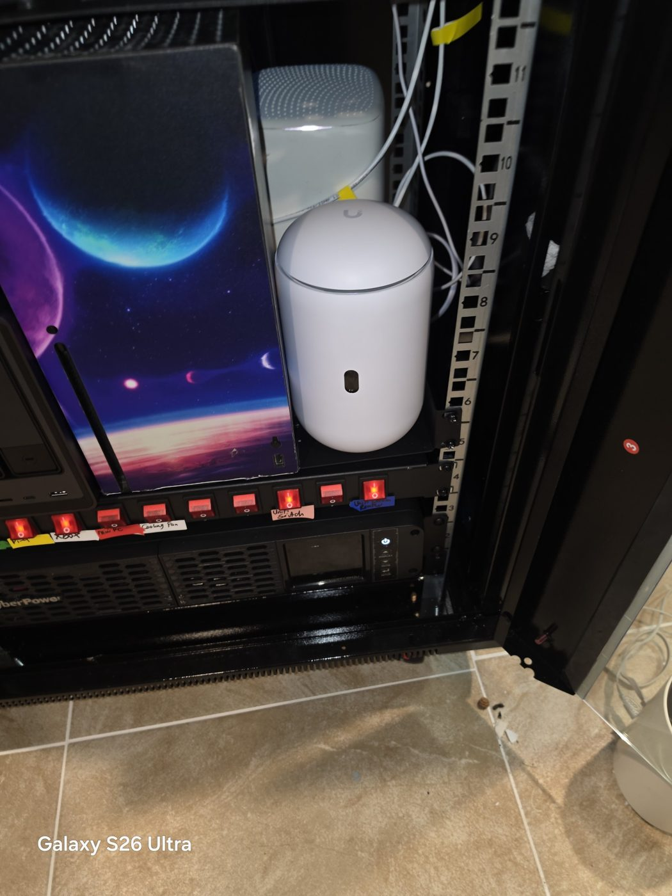

# Nonaldo Homelab

A home network and server build in a basement 15U rack, documenting hands-on work in networking, security, storage, and self-hosted services.

> **Author:** Homelab owner · Security+, CEH, CySA+
> **Started:** May 2026



---

## Diagrams

### Network


The physical path is on the left. On the right are the seven networks, the firewall policy between them, and what's planned next (dashed). Source: [`diagrams/network-diagram.py`](diagrams/network-diagram.py).

### Rack (3D render)



A Three.js model of the 15U rack, built from the [inventory](hardware/inventory.md) rack layout. Source: [`diagrams/rack-3d.html`](diagrams/rack-3d.html).

---

## Current Status

| Component | Status |
|---|---|
| Rack, PDU, UPS, thermostat cooling | ✅ Complete |
| UniFi core network (UDR7 + USW-Lite-8-PoE + 2x U7 Lite) | ✅ Complete |
| Structured cabling (24-port patch panel) | ✅ Complete |
| Intrusion Prevention (IPS) | ✅ Enabled — Notify and Block |
| Xbox Open NAT via UPnP | ✅ Complete |
| TP-Link Deco X68 mesh integrated in AP mode | ✅ Complete |
| VLAN segmentation (Kids, Gaming, Storage, IoT, Camera, Guest) | ✅ Complete |
| Zone-based firewall policies + gateway admin lockdown | ✅ Complete |
| Per-VLAN WiFi (IoT, Kids, Guest) | ✅ Complete |
| Proxmox VE 9.2 on Lenovo ThinkCentre (`10.0.50.20`) | ✅ Installed, updated, root 2FA + recovery keys |
| Uptime Kuma monitoring with phone alerts | ✅ Running |
| NAS (UGREEN DXP4800 Plus) — RAID 5 | 🔄 Waiting on replacement drive |
| [AdGuard Home](services/adguard.md) on Proxmox LXC (`10.0.50.22`) | ✅ Running (admin laptop only so far) |
| AdGuard backup on Pi 4 + network-wide DNS rollout | 🔄 Next |
| Home Assistant, Vaultwarden, Wazuh SIEM | 🔄 Planned |
| Tailscale / WireGuard remote access | 🔄 Planned |

---

## Stack

| Layer | Hardware / Software |
|---|---|
| ISP | Comcast Xfinity (gateway in bridge mode) |
| Gateway / firewall | UniFi Dream Router 7 |
| Switching | UniFi Switch Lite 8 PoE |
| Wireless | 2x UniFi U7 Lite (WiFi 7) + TP-Link Deco X68 (AP mode) |
| Storage | UGREEN NASync DXP4800 Plus, WD Red Plus 4TB (CMR) |
| Hypervisor | Lenovo ThinkCentre M80q Tiny — Proxmox VE 9.2 (i7-10700T, 32GB) |
| Compute | Beelink SER5 (Windows), Raspberry Pi 4 (backup DNS) |
| Power | CyberPower CP1500PFCRM2U UPS, 10-outlet switched PDU |
| Cooling | Tupavco TP1721 thermostat fan (77°F trigger) |

**Total confirmed hardware spend:** ~$2,200 (~$2,540 including UPS) — see [hardware/inventory.md](hardware/inventory.md).

---

## Repo Structure

```
homelab/
├── README.md
├── hardware/inventory.md   ← Every device, price, store, date + cost summary
├── network/topology.md     ← Physical layout, IPs, WAN, security settings
├── network/vlans.md        ← VLANs, port assignments, WiFi, test results
├── network/firewall.md     ← Firewall policies, UPnP, risk decisions
├── diagrams/               ← Network diagram (SVG + generator) and 3D rack model
├── services/               ← Proxmox, Uptime Kuma, AdGuard, Docker, Tailscale/WireGuard notes
├── logs/build-log.md       ← Dated build journal, issues and fixes
└── images/                 ← Build photos
```

---

## Build Photos

| | |
|---|---|
|  Empty 15U cabinet with fan and PDU installed |  Installing the USW-Lite-8-PoE |
|  UDR7 — 4x 2.5GbE + 10G SFP+ |  NAS, labeled PDU, CyberPower UPS |
|  UDR7 in the rack |  Finished rack, fan thermostat reading |
|  Lenovo ThinkCentre (Proxmox) on the NAS |  Proxmox VE 9.2 installed on the Storage VLAN |
|  Uptime Kuma watching the rack after an unplug test |  Proxmox on the no-subscription repo |
|  NAS drive bays (bay 4 tray pulled out) |  UDR7 beside the ISP gateway in bridge mode |
|  WD Red Plus (CMR) going into its tray |  U7 Lite on the main floor, PoE run down the trim |
|  Closed rack, front view, at 78.6°F |  All four UniFi devices online |
|  Policy blocking untrusted VLANs from the router admin page |  Installer pulled a Storage VLAN address, confirming the trunk port |

---

## Skills Demonstrated

- Gateway, switch, and AP deployment in the UniFi ecosystem
- ISP gateway bridge mode to eliminate double NAT
- Intrusion prevention and firewall configuration
- Integrating third-party mesh (Deco) in AP mode without double NAT
- UPnP / NAT troubleshooting for gaming consoles
- Rack building, power distribution, UPS, and thermal management
- Hardware selection trade-offs (CMR vs SMR, copper vs CCA, NAS model comparison)
- VLAN segmentation by trust level, with least-privilege switch port profiles
- Zone-based firewall design, including management-plane lockdown for untrusted segments
- Documented risk acceptance for an end-of-life IoT vendor, with compensating controls
- Bare-metal hypervisor deployment (Proxmox VE) with VLAN-verified networking and post-install hardening (repos, patching, 2FA)
- Containerized service deployment (LXC + Docker) and monitoring with tested alerting
- Troubleshooting: BitLocker/Secure Boot interaction, firewall rule misconfiguration, AP SSID limits, MAC randomization
- Planned: DNS filtering, SIEM (Wazuh), self-hosted services, VPN
