# Homelab Build Log

Chronological record of the build: what was done, decisions made, and problems solved.

---

## May 2026 — Planning & Rack

- Planned rack placement and consolidated all compute (Beelink SER5, Raspberry Pi 4, NAS) into one rack
- Compared UGREEN DXP4800 Plus vs DXP4800 GT — chose the **Plus** (stronger CPU, DDR5)
- **May 20:** Ordered SucceBuy 15U wall-mount cabinet ($119.39) and 10-outlet switched PDU ($39.68) from AliExpress
- Ordered UGREEN DXP4800 Plus + UPS bundle ($689.70 after coupon)

## June 2026 — Networking Hardware & Cabling

- Ordered UniFi Dream Router 7, Switch Lite 8 PoE, and 2x U7 Lite from the Ubiquiti Store ($670.02 total)
- **Jun 6–8:** Sokqovt Cat6a slim patch cables and 24-port patch panel delivered
- **Jun 23:** Ordered Tupavco TP1721 thermostat rack fan, Pyle 1U shelves, short patch cables, cable tags, XXONE 100 ft Cat7
- **Jun 25–27:** Ordered Jadaol outdoor Cat6 runs (100 ft, 35 ft) and 2x WD Red Plus 4TB
- Decision: WD Red **Plus** (CMR) instead of WD Red (SMR) for RAID
- Decision: pure copper cable only, no CCA, for PoE runs
- Deferred NVMe cache drives due to high SSD prices

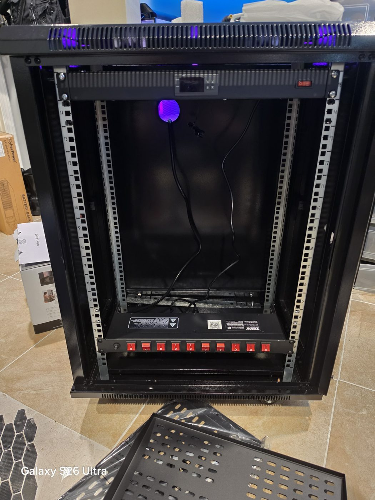

## July–August 2026 — Core Network Online

- Reset the Xfinity gateway and put it in **bridge mode** so the UDR7 is the only router (no double NAT)
- Connected UDR7 WAN to the gateway on port 4 (2.5GbE)
- Installed USW-Lite-8-PoE and wired it through the patch panel
- Adopted both U7 Lite APs (solid blue = adopted and online)
- Kept the original SSID and password so every existing device reconnected with no changes
- Labeled every PDU switch by device

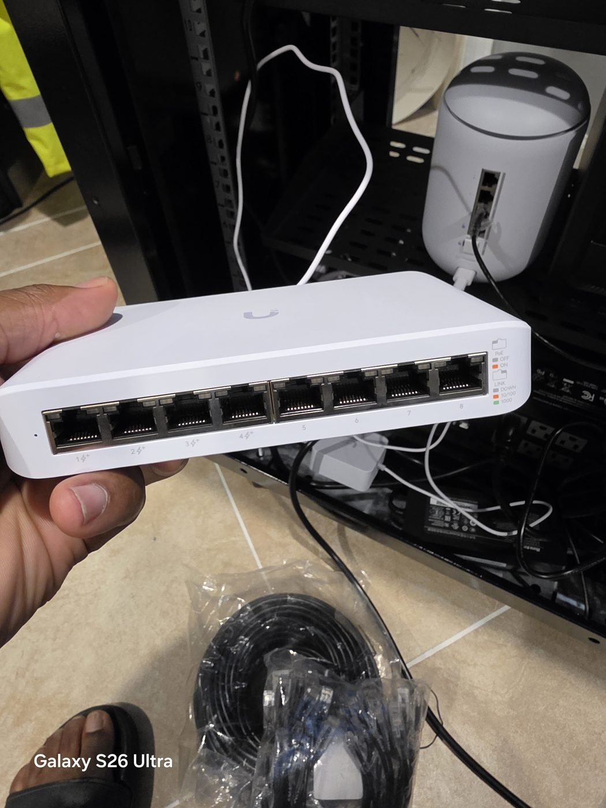

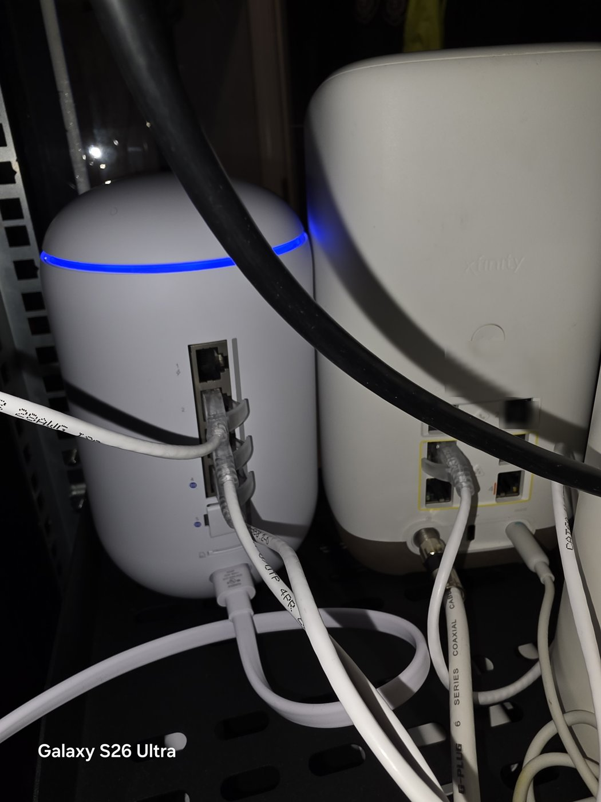

*UDR7 (left) beside the ISP gateway in bridge mode. The gateway's only job is to hand the WAN to the UDR7. The label on the gateway is blurred.*

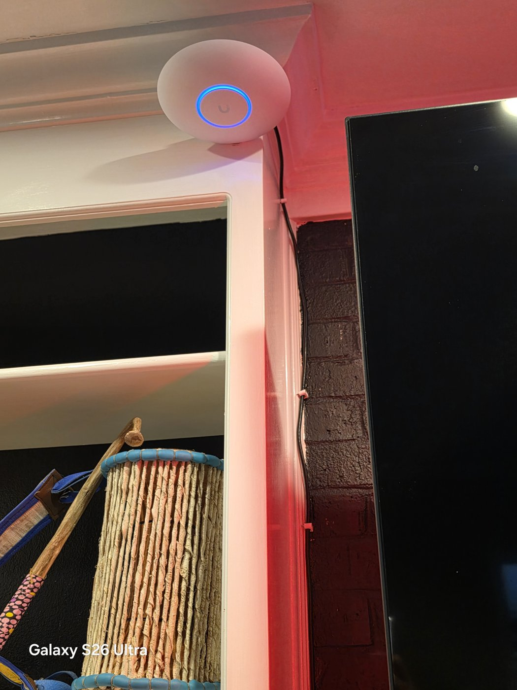

*U7 Lite on the main floor, mounted high on the bookshelf with the PoE cable clipped down the trim. Solid blue ring = adopted and online.*

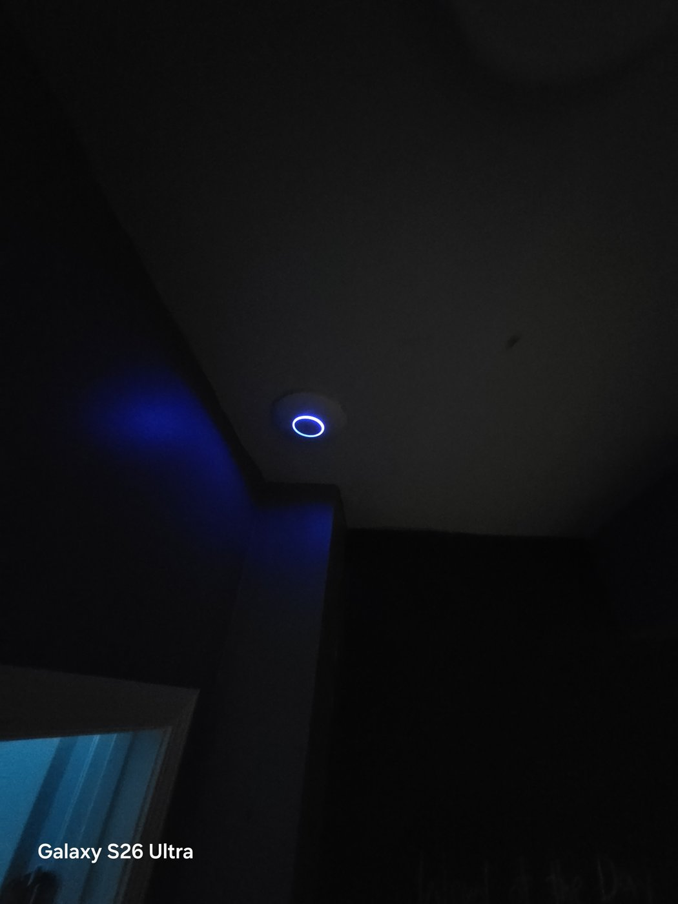

*Second U7 Lite on the basement ceiling, close to the rack.*

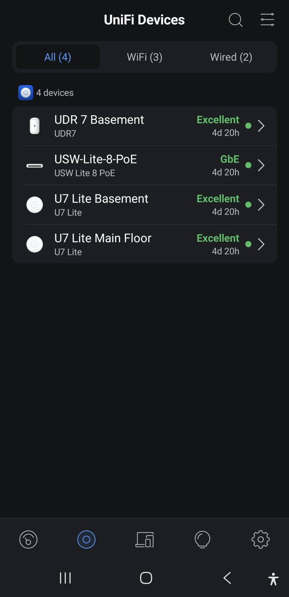

*UniFi app: UDR7, switch and both APs adopted and online, with 4d 20h uptime and Excellent experience. Phone status bar cropped off.*

## September 2026 — Integration & Hardening

### TP-Link Deco X68 mesh
- Main Deco was running as its own router on `192.168.68.1` (double NAT)
- Switched it to **Access Point mode** and wired it to the switch
- Satellite in another room uses wireless backhaul; PS5 wired to the satellite

### Xbox NAT
- Problem: Xbox reported **NAT Type: Moderate**, UPnP unsuccessful
- Fix: Enabled UPnP on the UDR7 WAN for the Default network
- Result: **NAT Type: Open** ✅

### Security
- Enabled **Intrusion Prevention** — Notify and Block, 13 of 13 categories
- Confirmed the UDR7 has no built-in ad blocking → AdGuard Home planned

### Thermal management
- Rack reached **84.3°F** with the Xbox Series X inside the cabinet (top-venting console)
- Set the Tupavco STC-1000 thermostat to **77°F** (hold S for 3s → F1 → adjust → power to save)
- Moved the Xbox out of the rack to the top of the cabinet
- Rack settled around 79°F; fan cycles on/off near the setpoint as designed

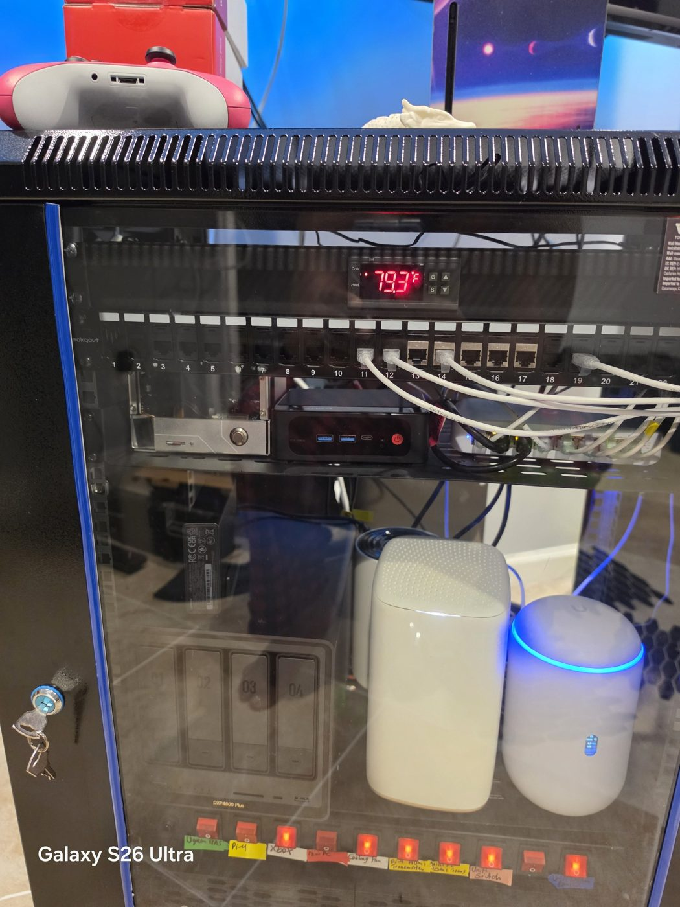

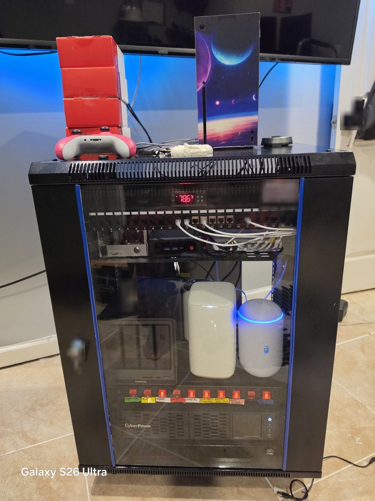

*Finished rack with the door closed and the Xbox moved on top, reading 78.6°F. Door keys, a wall keypad and labels are blurred.*

### Remote access
- Logged into unifi.ui.com Site Manager — UDR7 not yet linked to the cloud account (Online: 0). Pending.

### Documentation
- Created this GitHub repo as a build portfolio

## Late September 2026 — Cameras, NAS and a Hypervisor

### Camera VLAN
- Built the Camera VLAN (70) first, isolated, with a Default → Camera allow policy
- Moved the third-party IP cameras and the video doorbell onto it
- Found the camera vendor has been discontinued: no more firmware updates. Recorded as a risk (see [firewall.md](../network/firewall.md))

### NAS
- Installed the WD Red Plus drives in the UGREEN DXP4800 Plus
- One drive was never detected in any bay. A bay-swap test proved the drive, not the bay, was bad, so it went back for RMA
- RAID 5 across all four drives will be built when the replacement arrives

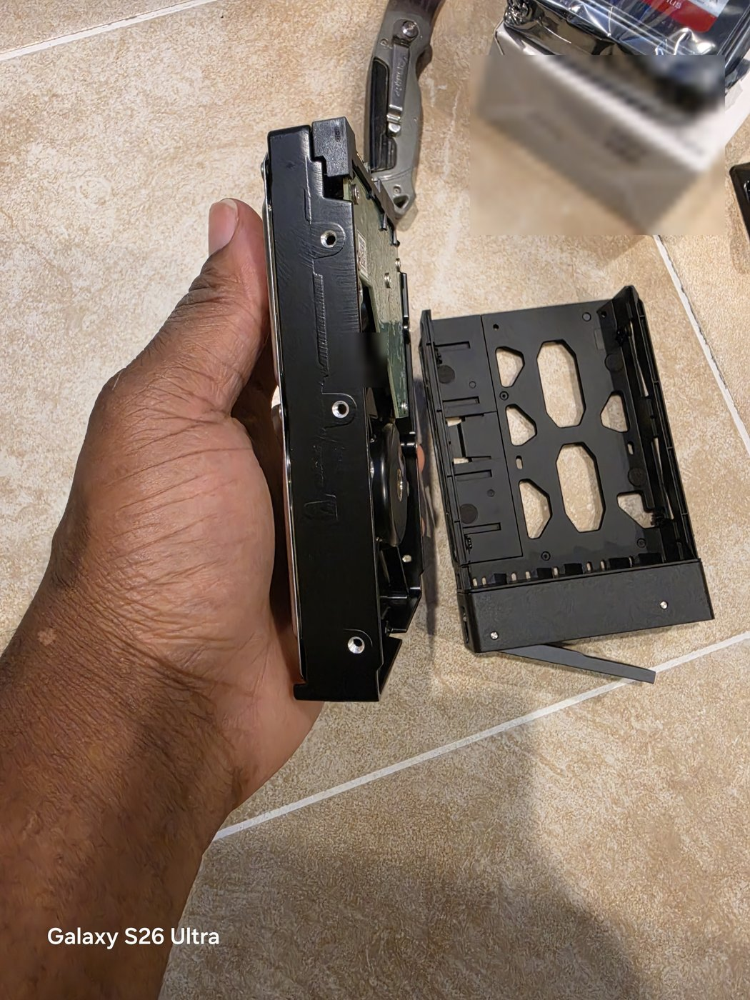

*Fitting a WD Red Plus into its tool-less tray. Serial labels blurred.*

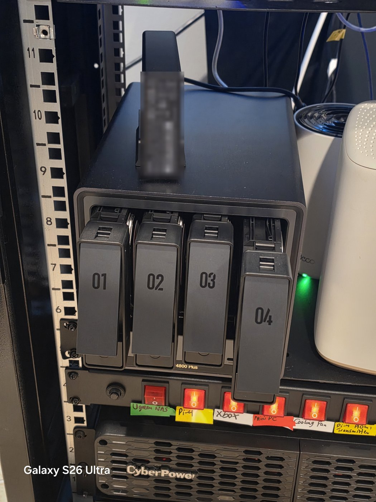

*DXP4800 Plus in the rack with the bay 4 tray pulled out. Battery label blurred.*

### Hypervisor
- Chose a used Lenovo ThinkCentre M80q Tiny ($200, i7-10700T, 32GB) as the dedicated Proxmox host instead of a $400 RAM upgrade for the Beelink
- Pre-purchase/handover checks: no BIOS supervisor password, SSD health 97%, no corporate MDM enrollment
- BIOS: VT-x/VT-d on, auto power-on after power loss, Secure Boot off
- Built the Proxmox USB with Rufus in DD mode. Caught that the first ISO downloaded was ARM64 and replaced it with the amd64 build

## October 4, 2026 — Segmentation Finished, Proxmox Installed

### Wired devices moved to VLANs
- Raspberry Pi 4 → Storage (50)
- Xbox Series X → Gaming (40); added Gaming to UPnP, still Open NAT
- Corporate-managed work laptop → IoT (60); VPN and Microsoft 365 confirmed working
- Beelink stays on Default; the Deco mesh left on Default for now
- All end-device switch ports set to **Block All** tagged VLANs (least privilege)

### Firewall
- Added **Allow Default → IoT**
- Added **Block Kids/Gaming/IoT/Camera → Gateway on TCP 22/80/443**, so untrusted VLANs can't reach the router's admin page or SSH. DNS/DHCP/NTP left open
- Caught and fixed a mistake: management ports had been entered as *source* ports instead of *destination* ports

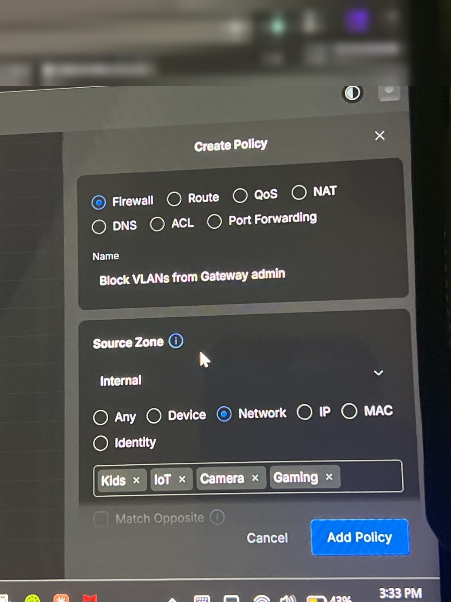

### WiFi
- Created SSIDs for IoT (2.4 GHz only, MLO/band steering/fast roaming off), Kids and Guest
- Guest: no captive portal, Client Device Isolation on, 5 GHz only after hitting the APs' 2.4 GHz SSID limit

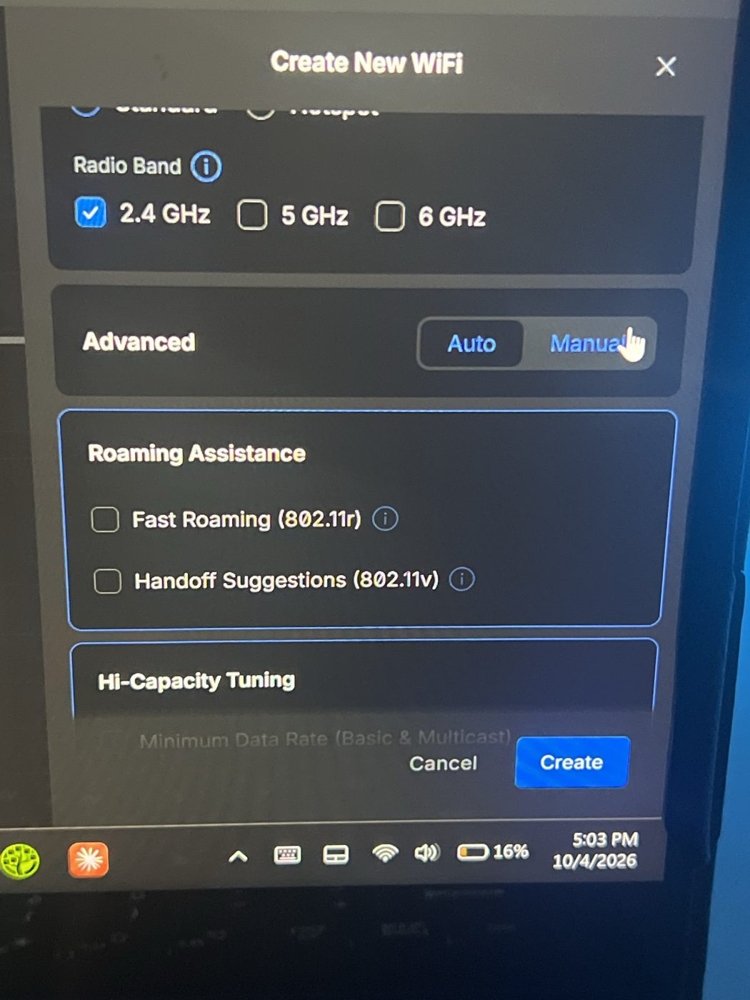

### Proxmox VE 9.2 installed
- UDR7 Port 1 set to native Storage (50), tagged Allow All
- Installer pulled `10.0.50.203` from DHCP, proving the VLAN worked before anything was committed
- Installed to the 256GB NVMe (ext4), static `10.0.50.20`, hostname `pve.home.lan`
- Reserved the IP and added a local DNS record in UniFi
- Logged into the web UI from the trusted network

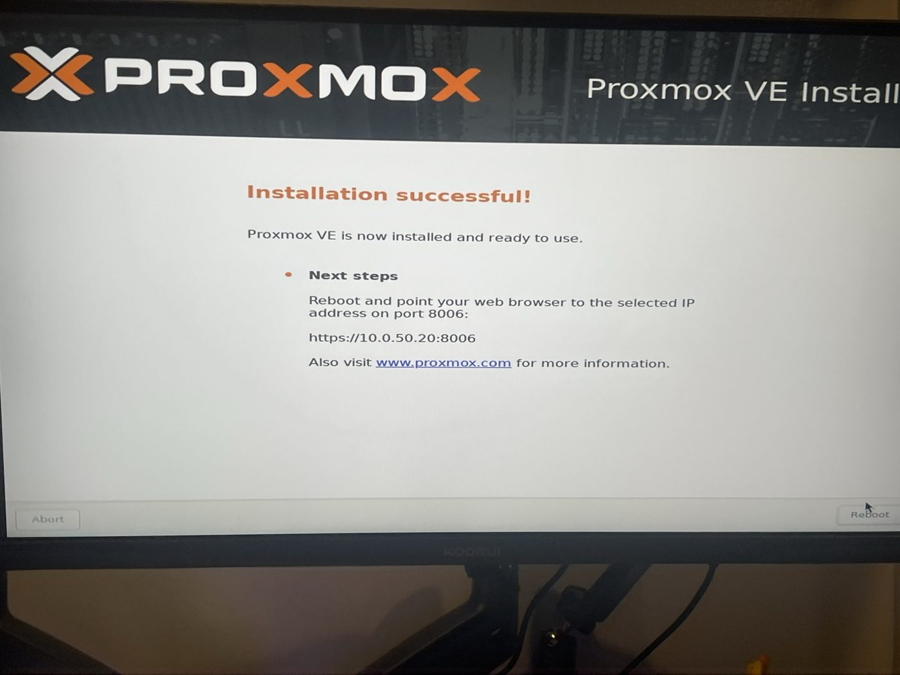

### Admin login alerts
- Investigated repeated "new admin login" emails from the UDR7. Traced the source IP to my own laptop: it sleeps often, so sessions expire, and Windows random MAC addresses gave it new IPs. Turned off random MAC for the home network and named the device in UniFi

### Raspberry Pi 4 joins the Storage VLAN
- The Pi kept its old `192.168.1.x` lease on both wired and WiFi after its switch port moved, so it couldn't reach Proxmox (`ERR_ADDRESS_UNREACHABLE`)
- Turned off the Pi's WiFi (a server on Storage shouldn't also sit on the trusted network) and rebooted; it came back at `10.0.50.30`
- Reset the forgotten Pi login password from the logged-in session, then turned off desktop and console auto-login so the Pi needs a password and the Chromium keyring unlocks with it
- The Pi is now the rack's admin workstation for the Proxmox web UI

### Proxmox hardened
- Switched to the no-subscription repository, upgraded 111+ packages, rebooted
- TOTP two-factor on `root@pam`; `vmbr0` made VLAN aware

### First service: Uptime Kuma
- Debian 13 LXC (CT 100) at `10.0.50.21`, Docker inside, Uptime Kuma 2 with SQLite
- Six monitors (gateway, Proxmox, Pi, NAS, internet, web) with ntfy phone alerts
- Pulled the Pi's cable to test: got DOWN and UP alerts
- Reserved every Storage IP in UniFi: `.1` gateway, `.20` Proxmox, `.21` Uptime Kuma, `.30` Pi, plus the NAS

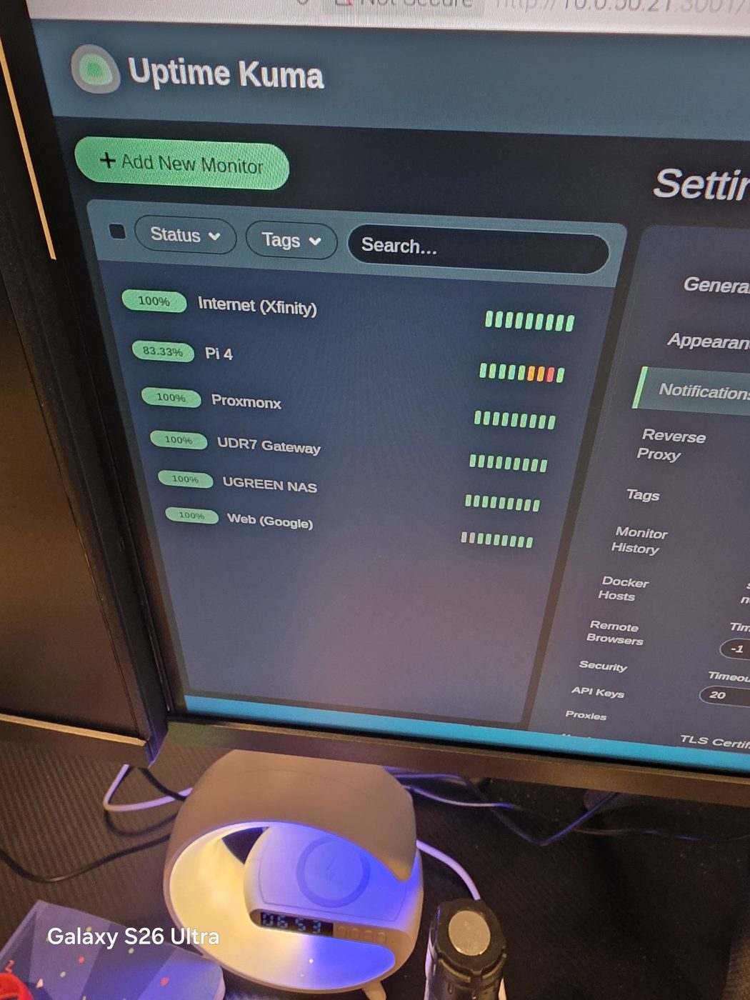

---

## October 5, 2026 — AdGuard Home Deployed

- New Debian 13 LXC (**CT 101**) at `10.0.50.22`, with nesting on and start at boot
- AdGuard Home web UI on port 80, DNS on 53
- Upstreams: Quad9 and Cloudflare over DNS-over-HTTPS
- Blocklists: AdGuard DNS filter, HaGeZi Pro, Phishing URL Blocklist, HaGeZi Threat Intelligence Feeds (about 3 million rules), plus browsing security
- Query log kept 7 days, statistics 30 days
- **Problem:** the container ran out of memory at 512MB while loading the lists. Raised it to **2GB**.
- Added Uptime Kuma monitors for AdGuard DNS and the web UI
- Pointed only the admin laptop at it for now. The other VLANs move over after the Pi backup and the port 53 firewall rule are in place.
- Details: [services/adguard.md](../services/adguard.md)

---

## October 6, 2026 — Proxmox 2FA Recovery Keys

- Generated **recovery keys** for the `root@pam` TOTP second factor and stored them in the password vault
- Why: TOTP lives on one phone. If that phone is lost or reset, the recovery keys are the only way into the Proxmox web UI without console access and a manual 2FA reset
- Keys stay in the vault only, never in this repo or in screenshots

### Documentation and privacy review
- Added numbered build steps to AdGuard Home, Uptime Kuma, VLANs, switch ports, SSIDs and firewall policies, so each item shows how it was built, not just the result
- Added the two AdGuard monitors to the Uptime Kuma page
- Rewrote the Docker page (one LXC per service instead of one Docker host) and the WireGuard page (Tailscale chosen first, with reasons) to match the real build
- Privacy sweep against rule 1:
  - Removed a personal name from the README and the Pi login username from two service pages
  - Blurred the Proxmox NIC's MAC address (image 09), plus the browser bookmarks bar and profile initial (images 11 and 12)
  - Confirmed no photo carries EXIF or GPS location data
- Why: a MAC address, usernames and bookmarks tell an attacker which hardware is in use, which logins to try and which services the owner uses. None of them belong in a portfolio.

## October 6, 2026 — Build Photos Added

- Added eight photos (16–23):
  - NAS drive bays, and a drive going into its tray
  - The UDR7 beside the ISP gateway
  - Both U7 Lite APs (main floor close-up and room view, plus basement)
  - The UniFi app with all four devices online
  - The closed rack from the front
- Before committing, blurred:
  - Serial and barcode labels on the drive, its box and the NAS battery
  - The model and label sticker on the ISP gateway
  - A family photo and a reflection in the TV in the room shot
  - The rack door keys and a wall keypad (a clear photo of a key or a keypad helps someone copy or guess it)
  - The phone status bar on the app screenshot
- Re-encoded each photo to remove its metadata
- Why: serial numbers can be used for warranty or support social engineering, and family photos are personal data. The portfolio needs neither.

## October 6, 2026 — Network Diagram and 3D Rack Render

- Added `diagrams/network-diagram.svg`, generated by `diagrams/network-diagram.py`. It shows:
  - The physical path: ISP gateway in bridge mode → UDR7 → Proxmox, NAS and switch
  - All seven networks, with subnets and members
  - The allow policies from Default to Storage, IoT and Camera
  - The rule blocking untrusted VLANs from the gateway's admin ports
  - The planned work, in order
- Added a 3D render of the rack (`images/24-rack-3d-render.jpg`), modeled in Three.js from the inventory's rack layout (`diagrams/rack-3d.html`)
- Why: one picture shows the trust boundaries faster than the tables do. The diagram is generated from a script, so it's easy to update as the network changes.
- The diagram has no public IPs, SSID names, MAC addresses or keys

## October 7, 2026 — Public Portfolio Privacy Pass

- Removed the household size and references to a family member from the public copy, including the label in the 3D rack render
- Why: neither adds anything technical, and family details don't belong in a public portfolio
- Kept: private RFC 1918 subnets and device IPs. They can't be reached from the internet, and showing them is what makes the segmentation readable.

---

## Next Steps

- [x] Build the VLANs, SSIDs and firewall rules
- [x] Install Proxmox VE on a dedicated host
- [x] Proxmox post-install: no-subscription repo, updates, root 2FA, VLAN-aware bridge
- [x] Uptime Kuma with phone alerts
- [x] Proxmox 2FA recovery keys stored in the password vault
- [ ] Test each new SSID (correct subnet and internet)
- [ ] Move smart devices to the IoT SSID and kids' devices to the Kids SSID
- [x] Deploy AdGuard Home on Proxmox (CT 101, `10.0.50.22`)
- [ ] AdGuard backup on the Pi 4, DNS allow policy, then switch each VLAN's DNS over
- [ ] Install the replacement drive and build RAID 5 on the NAS
- [ ] Tailscale/WireGuard remote access, then cut the discontinued cameras off the internet
- [ ] Deploy Home Assistant, Vaultwarden, Portainer, CrowdSec, Wazuh
- [ ] Move the Deco mesh to Gaming and drop Default from UPnP

---

## Issues & Resolutions

| Issue | Cause | Resolution |
|---|---|---|
| Xbox NAT Moderate | UPnP off on UDR7 | Enabled UPnP → Open NAT |
| Deco clients on separate 192.168.68.x subnet | Deco in router mode (double NAT) | Switched Deco to AP mode, wired to switch |
| Deco app "Unable to connect" after mode change | Deco rebooting into AP mode | Waited for reboot to finish |
| Rack at 84°F | Xbox venting heat inside cabinet | Moved Xbox out; fan set to 77°F |
| Fan off at 79°F | Thermostat hysteresis near setpoint | Normal behavior, no change needed |
| IPS showed Disabled after saving | Setting didn't persist | Re-enabled and re-saved |
| UniFi app stuck on loading screen | App glitch | Force-closed and reopened |
| No "Remote Access" toggle in app | Moved to unifi.ui.com in newer firmware | Link console via Site Manager (pending) |
| NAS drive missing in one bay | Drive dead on arrival | Bay-swap test isolated the drive; RMA |
| BitLocker recovery screen on the Lenovo | Secure Boot disabled for Proxmox | Skipped Windows; disk wiped by the installer |
| Firewall block rule wouldn't match | Ports entered as source ports | Moved them to destination ports |
| Guest SSID couldn't use 2.4 GHz | AP per-radio SSID limit | Guest is 5 GHz only |
| IoT SSID security locked to WPA2/WPA3 | 6 GHz and MLO require WPA3 | Set IoT to 2.4 GHz only, MLO off |
| Proxmox "update package database" failed | Enterprise repo needs a subscription | Switched to the no-subscription repo |
| Repeated UDR7 login alert emails | Laptop sleep + Windows random MAC | Random MAC off at home, device named |
| Pi couldn't reach Proxmox | Pi held old 192.168.1.x leases on wired + WiFi | WiFi off, reboot → `10.0.50.30` |
| Chromium keyring prompt on the Pi | Auto-login never unlocks the keyring | Auto-login off; keyring password = login password |
| Uptime Kuma page wouldn't load | `docker run` never completed | Re-ran it; container Up |
| AdGuard LXC ran out of memory loading blocklists | 512MB too small for about 3M rules | Raised RAM to 2GB |
| New photos showed serial labels, an ISP gateway sticker, a family photo, door keys and a keypad | Phone photos of real rooms and hardware | Blurred before committing; EXIF removed |
| Screenshots exposed a MAC address, browser bookmarks and a profile initial; README held a personal name | Images and text added without a privacy check | Blurred the images, removed the name and username, and checked EXIF |
