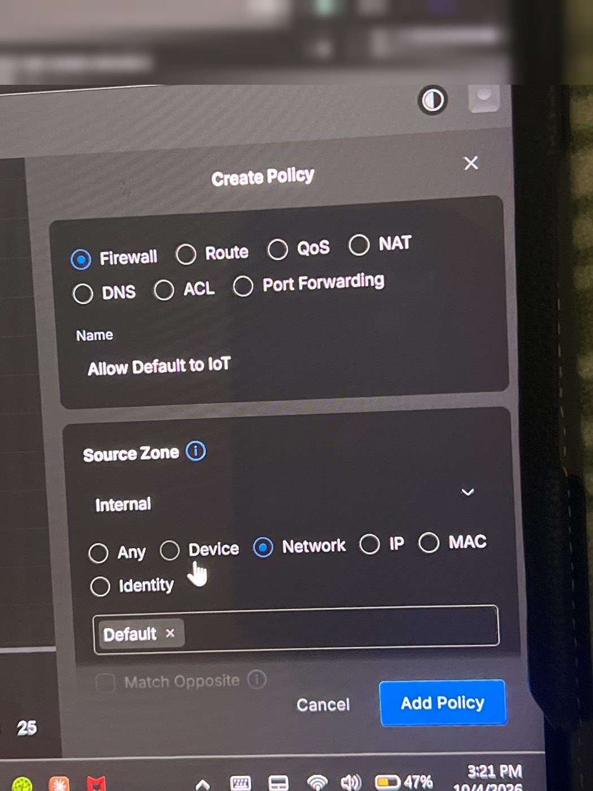

# Firewall Policies

UniFi Network zone-based firewall on the UDR7. Every VLAN except Default has **Isolate Network** on, so inter-VLAN traffic is denied by default. The policies below punch the specific holes that are needed and add hardening on top. Allow policies sit above block policies, and return traffic is allowed automatically, so a device can answer a connection without being able to start one.

---

## Active Policies

| # | Name | Action | Source | Destination | Ports | Why |
|---|---|---|---|---|---|---|
| 1 | Allow Default to Camera | Allow | Internal → Default | Internal → Camera | Any | View cameras from trusted devices |
| 2 | Allow Default to Storage | Allow | Internal → Default | Internal → Storage | Any | Reach the NAS and the Proxmox web UI |
| 3 | Allow Default to IoT | Allow | Internal → Default | Internal → IoT | Any | Control smart devices and cast to TVs |
| 4 | Block VLANs from Gateway admin | Block | Internal → Kids, Gaming, IoT, Camera | Gateway | TCP 22, 80, 443 | Untrusted segments can't reach the router's SSH or web UI |

### Build steps (UniFi Network app)

1. **Settings → Policy Engine → Create Policy**, type **Firewall**
2. **Name:** e.g. `Block VLANs from Gateway admin`
3. **Source Zone:** Internal → **Network** → Kids, IoT, Camera, Gaming
4. **Action:** Block
5. **Destination Zone:** Gateway · **Port:** `22, 80, 443` in the **destination** port field, TCP
6. **Add Policy**, then check that allow policies sit above block policies in the list
7. Test from a device on an isolated VLAN: `http://10.0.x.1` must not load, and internet and DNS must still work

The allow policies (1–3) use the same steps with **Action: Allow**, Source Network **Default**, and the target zone as the destination.

### Policy 4 notes

- Only management ports are blocked. DNS (53), DHCP (67/68) and NTP (123) to the gateway stay open, or the isolated VLANs would lose internet.
- Default is excluded so the admin network keeps management access.
- Storage is excluded for now because Uptime Kuma and Wazuh will need to reach the UDR7. It will be narrowed to specific ports once those are running.
- Guest is covered by the Hotspot zone's built-in gateway block.
- **Mistake caught during build:** the ports were first entered in the *source* port field. Source ports are random high ports on the client, so the rule would almost never have matched. Moved them to the *destination* port field.

---

## UPnP

- UPnP is enabled on the WAN for the **Default** and **Gaming** networks only, with **Secure Mode** on, so a device can only open ports for itself.
- Gaming is needed for Xbox Open NAT. Default stays only until the PS5 (behind the Deco on Default) moves to Gaming.
- An audit of active UPnP mappings confirmed nothing unexpected was exposed and port 443 was not forwarded.

---

## Intrusion Prevention

- IPS is enabled in **Notify and Block** mode, with all 13 detection categories on.

---

## Planned Policies

| Name | Action | Source | Destination | When |
|---|---|---|---|---|
| Allow DNS to AdGuard | Allow | All VLANs | AdGuard (Proxmox LXC) + Pi 4 backup, TCP/UDP 53 | After AdGuard Home is deployed |
| Block discontinued cameras from Internet | Block | Camera devices from the discontinued vendor (by MAC) | External | After a self-hosted VPN replaces the vendor cloud for remote viewing |
| Storage → Gateway narrowed | Allow only needed ports | Storage | Gateway | After Uptime Kuma and Wazuh are running |

### Risk decision: discontinued camera vendor

The vendor's cloud still works for remote viewing, so the cameras keep internet access for now. The risk is reduced because the Camera VLAN is isolated: a compromised camera can't reach any other network or the router's admin page. Once Tailscale or WireGuard is in place, remote viewing will go through the VPN and the cameras will be cut off from the internet. The long-term plan is to replace them with a supported platform.
