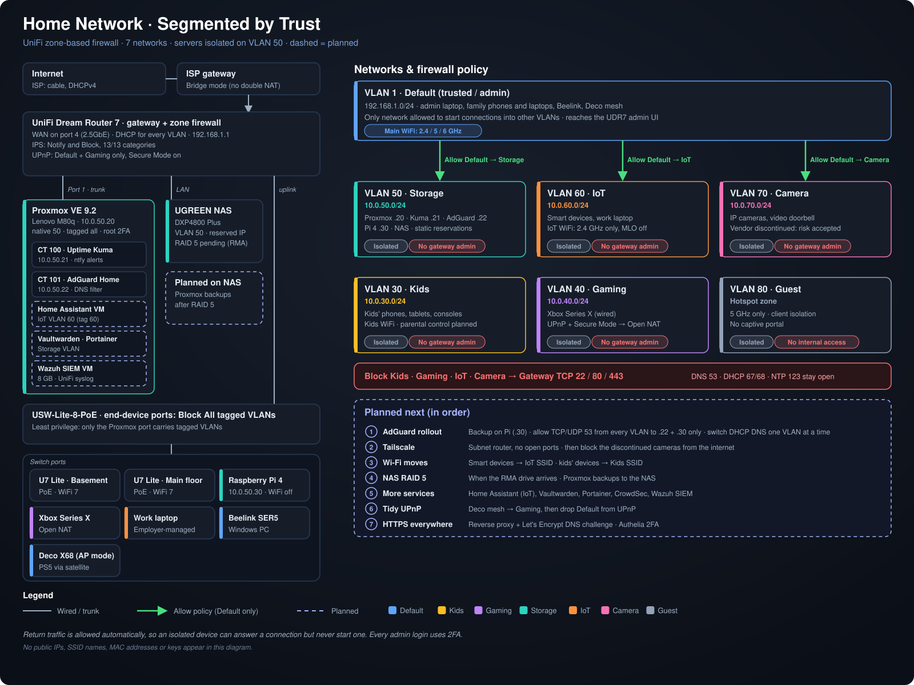
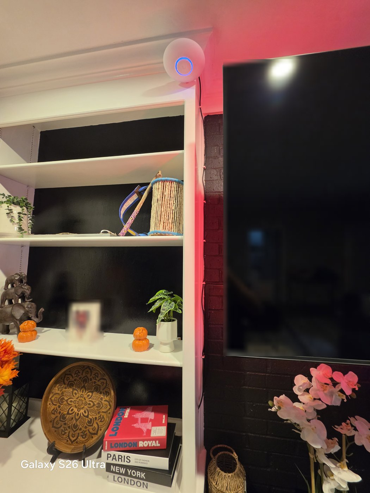

# Network Topology

## Physical Layout



*Full diagram: physical path, VLANs, firewall policy and planned work. Regenerate with `python3 diagrams/network-diagram.py`.*

```
[Comcast Xfinity gateway — bridge mode]
              |
         WAN (port 4, 2.5GbE)
              |
   [UniFi Dream Router 7 — 192.168.1.1]   ← routing, zone firewall, DHCP, IPS, WiFi 7
      |                 |                     |
   Port 1            NAS port            Switch uplink
      |                 |                     |
 [Lenovo ThinkCentre] [UGREEN NAS]   [UniFi Switch Lite 8 PoE]
  Proxmox VE           Storage 50       |        |        |       |      |        |
  10.0.50.20                         [U7 Lite][U7 Lite][Beelink][Pi 4] [Xbox]  [Work laptop]
  Storage 50 + tagged                 (PoE)    (PoE)   Default  Stor.50 Gaming40 IoT 60
                                        |
                          [TP-Link Deco X68 main — AP mode, Default]
                                        | (wireless backhaul)
                          [Deco X68 satellite — wireless backhaul]
                                        |
                                    [PS5 wired]
```


*The UDR7 (left) next to the ISP gateway in bridge mode: one router, no double NAT.*



*Main-floor U7 Lite, mounted high and central for coverage, with PoE run down the trim. Personal items blurred.*


*All four UniFi devices adopted and online: one AP per floor, plus the router and switch.*

---

## Trusted Network

| Setting | Value |
|---|---|
| Network | Default, VLAN 1 (used as the trusted/admin network) |
| Subnet | `192.168.1.0/24` |
| Gateway | `192.168.1.1` (UDR7) |
| WiFi | Original SSID and password kept, so every existing device reconnected with no changes |

---

## WAN

| Setting | Value |
|---|---|
| ISP | Comcast |
| Interface | WAN1, UDR7 port 4 (2.5GbE); port 5 (10G SFP+) unused |
| Addressing | DHCPv4 |
| UPnP | Enabled for Default and Gaming only, Secure Mode on (Xbox Open NAT) |

---

## Security

| Feature | Status |
|---|---|
| Intrusion Prevention (IPS) | Enabled — Notify and Block, 13 of 13 detection categories |
| Firewall | Zone-based; isolated VLANs plus explicit allow/block policies (see [firewall.md](firewall.md)) |
| DNS filtering | AdGuard Home planned (UDR7 has no built-in ad blocking) |
| Remote access | UniFi Site Manager; Tailscale/WireGuard planned |
| SSH | Local-only device SSH, key-based auth planned |

---

## Third-Party Mesh Integration

The TP-Link Deco X68 mesh system was switched from router mode to **Access Point mode** (Deco app → More → Advanced → Operation Mode) and the main unit was wired to the switch. This removed the Deco's separate `192.168.68.x` subnet and the double NAT it created, so all its clients now get addresses from the UDR7.

---

## VLANs

Implemented October 2026. See [vlans.md](vlans.md) and [firewall.md](firewall.md).

| VLAN | Name | Subnet |
|---|---|---|
| 1 | Default (Trusted) | `192.168.1.0/24` |
| 30 | Kids | `10.0.30.0/24` |
| 40 | Gaming | `10.0.40.0/24` |
| 50 | Storage / Servers | `10.0.50.0/24` |
| 60 | IoT | `10.0.60.0/24` |
| 70 | Camera | `10.0.70.0/24` |
| 80 | Guest (Hotspot zone) | Guest range |
