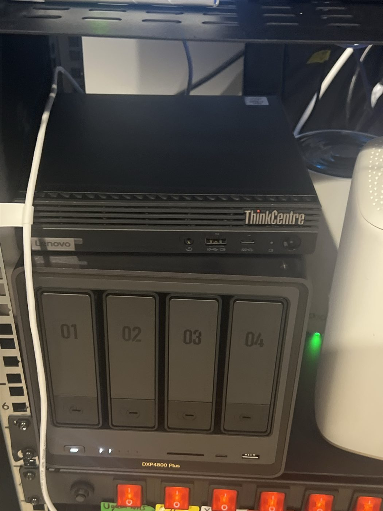
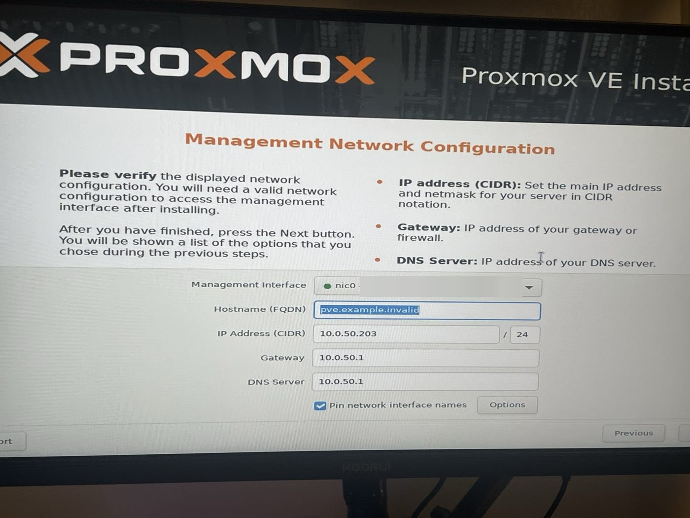
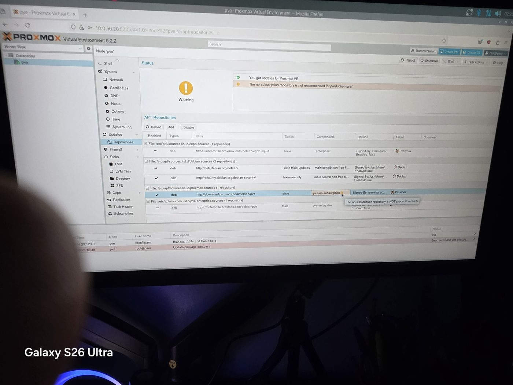

# Proxmox VE

## Status: ✅ Installed and hardened (October 4, 2026)

Proxmox VE 9.2 runs on a dedicated **Lenovo ThinkCentre Tiny** and will host all homelab VMs and LXC containers. The Beelink SER5 stays a Windows PC, and the Raspberry Pi 4 runs backup DNS.

---

## Host Hardware

| Spec | Value |
|---|---|
| **Device** | Lenovo ThinkCentre M80q Tiny |
| **CPU** | Intel Core i7-10700T (8 cores / 16 threads, 35W) |
| **RAM** | 32GB DDR4-2666 (2 slots, upgradeable to 64GB) |
| **Storage** | 256GB SK Hynix NVMe SSD (health 97%) |
| **Network** | Intel I219-LM Gigabit |
| **Acquired** | Used, $200 |

---

## Installation Record

| Setting | Value |
|---|---|
| Version | Proxmox VE 9.2 (ISO release 1), now 9.2.2 |
| Install media | USB flashed with Rufus in DD mode (amd64 ISO) |
| Target disk | `/dev/nvme0n1` (238GB SK Hynix) |
| Filesystem | ext4 / LVM (single disk, so ZFS's RAM cost isn't worth it) |
| Hostname | `pve.home.lan` |
| Management IP | `10.0.50.20/24` (static, also reserved in UniFi) |
| Gateway / DNS | `10.0.50.1` |
| Switch port | UDR7 Port 1: native VLAN Storage (50), tagged Allow All |
| Web UI | `https://10.0.50.20:8006` |
| Local DNS | `pve.home.lan` record on the UDR7 |

### Install steps

1. BIOS (F1): VT-x and VT-d on, After Power Loss → Power On, Secure Boot off
2. Set UDR7 Port 1 to native VLAN Storage (50), tagged Allow All
3. Booted the USB from the F12 menu (UEFI USB entry)
4. **Verified the VLAN before committing:** the installer's DHCP suggestion was `10.0.50.203` with gateway `10.0.50.1`, which proved the port change worked
5. Replaced the suggestion with static `10.0.50.20`, kept "Pin network interface names" on
6. Installed, removed the USB, rebooted
7. Reserved `10.0.50.20` for the host's MAC in UniFi and added the `pve.home.lan` DNS record
8. Logged into the web UI from the Default network (allowed by the Default → Storage policy)

### Issues during install

| Issue | Cause | Resolution |
|---|---|---|
| Downloaded an ARM64 ISO at first | Wrong architecture for an Intel CPU | Re-downloaded the amd64 ISO before flashing |
| BitLocker recovery screen on boot | Disabling Secure Boot changes the TPM measurements BitLocker checks | Not needed: the disk was being wiped, so skipped Windows and booted the installer |
| "Update package database" task failed after first login | Fresh installs point at the paid enterprise repository | Switch to the no-subscription repository (pending) |

---

## Post-Install Hardening

- [x] Disabled both enterprise repositories (PVE and Ceph) and added **pve-no-subscription**; kept the Debian and Debian-security repositories enabled
- [x] Refreshed and upgraded 111+ packages, then rebooted
- [x] **TOTP two-factor** enabled for `root@pam` and tested by logging out and back in
- [x] `vmbr0` marked **VLAN aware**, so each guest can be tagged onto any VLAN the trunk port carries
- [x] Recovery keys for root 2FA, stored in the password vault (Oct 6, 2026)
- [ ] NAS as a backup target with scheduled backups (after RAID 5 is built)
- [ ] Check CPU temperature under load (it sits on top of the NAS)

### Lessons from hardening

- A fresh install has **every** repository listed; I briefly disabled the Debian repositories along with the enterprise ones. The status panel only flagged the missing Proxmox repo, so I checked each line's `Enabled` state by hand.
- The web upgrade console pauses on package changelogs (`press q to quit`). It looks like a hang but is waiting for input.
- Commands typed into the Pi's own terminal run on the Pi, not on Proxmox. The prompt (`<user>@raspberrypi` vs `root@pve`) shows which machine you're on.

## Management Access

- Web UI reached from the trusted network, and from the Raspberry Pi 4 on the Storage VLAN
- The Proxmox host has no desktop; a monitor attached to it shows only a console login, so the Pi acts as the rack's admin workstation

---

## Planned VMs / Containers

| Service | Type | RAM | VLAN | Purpose |
|---|---|---|---|---|
| AdGuard Home | LXC (CT 101) | 2GB | Storage | ✅ **Running** at `10.0.50.22`, network-wide DNS filtering (Pi 4 secondary planned): see [adguard.md](adguard.md) |
| Home Assistant | VM | 2GB | IoT | Smart home automation |
| Portainer | LXC | 512MB | Storage | Docker container management UI |
| Vaultwarden | LXC | 512MB | Storage | Self-hosted password manager (Bitwarden-compatible) |
| Uptime Kuma | LXC (CT 100) | 1GB | Storage | ✅ **Running** at `10.0.50.21` — see [uptime-kuma.md](uptime-kuma.md) |
| CrowdSec | LXC | 256MB | Storage | Lightweight intrusion prevention |
| Wazuh | VM | 8GB (4 vCPU, 50GB+ disk) | Storage | Open-source SIEM/XDR: log collection, intrusion detection, file integrity monitoring, vulnerability alerts; ingests UniFi syslog |

**Total RAM about 16.5GB, leaving about 15.5GB free** on the 32GB host for a Windows VM or a security lab later.

---

## Resilience

- **Backup DNS:** a second AdGuard Home on the Pi 4, so a Proxmox reboot doesn't take the house offline
- **VM backups:** scheduled Proxmox backups to the NAS, restorable onto other hardware
- **Power:** auto power-on after an outage, and on the CyberPower UPS
